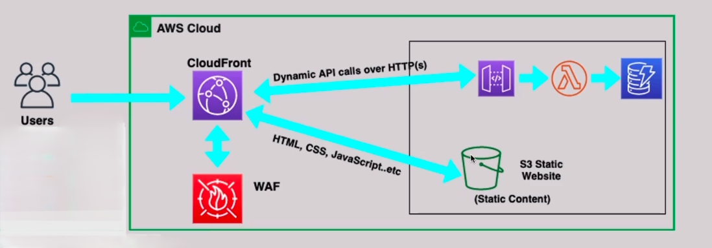

# AWS Serverless Web Application

## 📌 Overview
A production-grade, fully serverless web application hosted on AWS. This project demonstrates a cost-effective, highly available, and secure architecture that scales automatically with zero infrastructure overhead. It serves a global user base and protects against common web vulnerabilities.

## 🏗️ Architecture Diagram


## 🎯 Requirements Covered
1. **Static Content (Frontend):** HTML, CSS, and JS hosted in an S3 bucket configured as a Static Website.
2. **Dynamic Backend:** The frontend makes API calls to an API Gateway, which triggers AWS Lambda functions to perform operations on a DynamoDB database.
3. **Global Performance:** CloudFront is used to cache static content and route API calls globally.
4. **Security & Resilience:** AWS WAF is implemented to protect against common vulnerabilities (e.g., SQL injection, XSS) and block traffic from specific countries.
5. **High Availability & Scalability:** The solution is fully serverless, highly available, and scalable with zero ongoing infrastructure overhead.
6. **Cost-Effective:** Pay only for what you use (no idle EC2 instances).

## 🔧 AWS Services Used
| Service | Purpose |
|---------|---------|
| Amazon S3 | Hosting static frontend content |
| Amazon CloudFront | Global CDN and caching |
| AWS WAF | Web Application Firewall (Layer 7 security) |
| Amazon API Gateway | RESTful API management |
| AWS Lambda | Serverless compute for backend logic |
| Amazon DynamoDB | NoSQL database for dynamic data |
| AWS IAM | Access control and permissions |

## 📂 Repository Structure
```text
.
├── architecture/          # Architecture diagrams
├── screenshots/           # AWS Console screenshots (proof of implementation)
├── documentation/         # Requirements & design decisions
└── infrastructure-as-code/ # (Planned) Terraform implementation